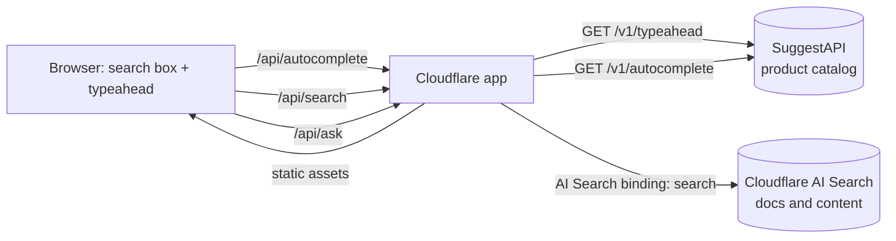

# Cloudflare Product Search

**Add fast product search and autocomplete to any site on Cloudflare.** Cloudflare AI Search answers questions from your docs and content; SuggestAPI searches your product catalog.

> **SuggestAPI is the Cloudflare for Search.** What Cloudflare did for delivery and security, SuggestAPI does for product search: a fast, managed search layer for your catalog that sits alongside Cloudflare, with typeahead, typo tolerance, filters, and hybrid keyword + vector ranking.

[](https://deploy.workers.cloudflare.com/?url=https://github.com/suggestapi/cloudflare-product-search)

This repo is a small, deployable starter for Cloudflare product search. It serves product search and autocomplete from Cloudflare's network using [SuggestAPI](https://www.suggestapi.com), and can optionally add answers from a Cloudflare AI Search instance for docs, policies, and help content. If you are looking at Cloudflare AI Search for ecommerce, this shows how the two fit together: AI Search for knowledge, SuggestAPI for buyable products with prices, typo tolerance, and filters.

## SuggestAPI: the Cloudflare for Search

Cloudflare made a fast, global edge something any team could switch on. SuggestAPI aims to do the same for product search. Instead of running and tuning your own search cluster, you send your catalog to SuggestAPI and call one API for search and autocomplete. It pairs naturally with a site on Cloudflare: Cloudflare AI Search handles your docs and content, and SuggestAPI handles the products shoppers can buy.

## Why two search layers

| Job | Use | Why |
| --- | --- | --- |
| Docs, policies, help center, blog | [Cloudflare AI Search](https://developers.cloudflare.com/ai-search/) | Managed retrieval over files and site content, returned as cited passages. |
| Product catalog | [SuggestAPI](https://www.suggestapi.com) | Ranked product results with title, price, image, and URL; hybrid keyword + vector ranking; exact and range filters (category, price); spell correction. |
| Search-as-you-type | SuggestAPI typeahead | A low-latency prefix endpoint built for autocomplete boxes. |

A shopper typing "ptfe pump" wants products they can buy, not a paragraph about pumps. A shopper asking "what is your return policy?" wants the policy page. This starter routes each to the right engine.

## Architecture



The SuggestAPI key stays on the server. The browser only calls your own `/api/*` routes.

## Quick start

Requires Node.js 22+ and a [SuggestAPI](https://www.suggestapi.com) account with a product index.

```bash
git clone https://github.com/suggestapi/cloudflare-product-search.git
cd cloudflare-product-search
npm install
cp .dev.vars.example .dev.vars   # then paste your SuggestAPI public key
npm run dev                      # http://localhost:8787
```

Deploy to your Cloudflare account:

```bash
npx wrangler secret put SUGGESTAPI_PUBLIC_KEY
npm run deploy
```

Or click **Deploy to Cloudflare** above. It forks the repo, asks for `SUGGESTAPI_PUBLIC_KEY`, and deploys.

## API

| Route | Backed by | Query params |
| --- | --- | --- |
| `GET /api/search` | SuggestAPI `GET /v1/autocomplete` | `q` (required), `limit` (1-50, default 12), `mode` (`hybrid` default, `fts_only`, `vector_only`, `fts_rerank`), `filters` (JSON), `user_id` |
| `GET /api/autocomplete` | SuggestAPI `GET /v1/typeahead` | `q` (required), `limit` (1-50, default 6) |
| `GET /api/ask` | Cloudflare AI Search `search()` | `q` (required), `limit` (1-50, default 5). Returns `501` until the binding is configured. |
| `GET /api/health` | | Shows which backends are configured. |

### curl

```bash
# Ranked product search with a category and price filter
curl -G "http://localhost:8787/api/search" \
  --data-urlencode "q=diaphragm pump" \
  --data-urlencode 'filters={"category":["Pumps"],"price":{"gte":100,"lte":1000}}'

# Autocomplete suggestions
curl "http://localhost:8787/api/autocomplete?q=ptf"

# Docs answer passages (needs the AI Search binding)
curl "http://localhost:8787/api/ask?q=what%20is%20your%20return%20policy"
```

The same product search, called directly against SuggestAPI:

```bash
curl "https://api.suggestapi.com/v1/autocomplete?index=products&query=diaphragm%20pump&limit=8&mode=hybrid" \
  -H "x-api-key: <public-key>"
```

`/api/search` and `/api/autocomplete` return SuggestAPI's response as-is: a `suggestions` array with `title`, `subtitle`, `url`, `image`, `price`, `currency`, and `score`, plus `corrected_query` when spell correction applied.

## Configuration

| Name | Type | Where | Description |
| --- | --- | --- | --- |
| `SUGGESTAPI_PUBLIC_KEY` | secret | `.dev.vars` / `wrangler secret put` | SuggestAPI public (search) key, sent as `x-api-key`. |
| `SUGGESTAPI_INDEX` | var | `wrangler.jsonc` | Index that holds your catalog. Default `products`. |
| `SUGGESTAPI_BASE_URL` | var | `wrangler.jsonc` | Optional. Default `https://api.suggestapi.com`. |
| `DOCS_SEARCH` | AI Search binding | `wrangler.jsonc` | Optional. Enables `/api/ask`. |

### Turn on Cloudflare AI Search for docs

1. Create an AI Search instance and point it at your docs site or an R2 bucket ([guide](https://developers.cloudflare.com/ai-search/get-started/)).
2. Uncomment the `ai_search` block in `wrangler.jsonc` and set `instance_name`:

```jsonc
"ai_search": [
  { "binding": "DOCS_SEARCH", "instance_name": "my-docs", "remote": true }
]
```

3. Redeploy. The demo page shows a "From the docs" panel under the product results.

### Load your catalog

Products live in a SuggestAPI index. Connect a store or existing search engine from the SuggestAPI console, or push documents with [`@suggestapi/sdk`](https://www.npmjs.com/package/@suggestapi/sdk):

```ts
import { createSuggestApiClient } from "@suggestapi/sdk/node";

const client = createSuggestApiClient({ bearerToken: process.env.SUGGESTAPI_BEARER_TOKEN });

await client.documents.bulkUpsert("products", {
  documents: [
    {
      id: "sku_1001",
      title: "PTFE Diaphragm Pump",
      desc: "Chemical-resistant pump for demanding transfer jobs",
      manufacturer: "LMI",
      raw: { category: "Pumps", price: 499.99, product_url: "https://example.com/products/sku_1001" }
    }
  ]
});
```

Run indexing from a trusted server or script. Never ship a bearer token to the browser.

## Project layout

```
public/            demo UI: search box, typeahead dropdown, product grid
src/index.ts       /api/search, /api/autocomplete, /api/ask
wrangler.jsonc     Cloudflare config (static assets, vars, optional AI Search binding)
.dev.vars.example  local secrets template
```

## FAQ

**Can Cloudflare AI Search do product search?**
It can retrieve text about products, but it returns passages from files and pages, not ranked catalog records with live prices, images, and filters. For ecommerce, keep AI Search on docs and content and send product queries to a catalog search API. That is the split this starter uses.

**How do I add autocomplete to a Cloudflare site?**
Deploy this starter, then call `/api/autocomplete?q=` from your search input with a short debounce (the demo uses 120 ms). `public/app.js` has a working, keyboard-accessible example you can copy.

**Is the API key exposed to the browser?**
No. The key is a server-side secret; the browser only talks to your own routes.

**Can I filter by category, brand, or price?**
Yes. Pass `filters` as JSON to `/api/search`, for example `{"category":["Pumps"],"price":{"gte":100,"lte":1000}}`.

**Does it work with Shopify, Algolia, Typesense, or Elasticsearch?**
SuggestAPI can sit in front of an existing catalog or search engine. See [suggestapi.com](https://www.suggestapi.com).

## Learn more

- [SuggestAPI for Cloudflare AI Search](https://www.suggestapi.com/for/cloudflare-ai-search/)
- [SuggestAPI](https://www.suggestapi.com)
- [Cloudflare AI Search docs](https://developers.cloudflare.com/ai-search/)

SuggestAPI is not a Cloudflare product. Cloudflare and Cloudflare AI Search are trademarks of Cloudflare, Inc.

## License

[MIT](./LICENSE) © SuggestAPI

---

SuggestAPI is an independent product and is not affiliated with or endorsed by Cloudflare, Inc. Cloudflare is a trademark of Cloudflare, Inc.
